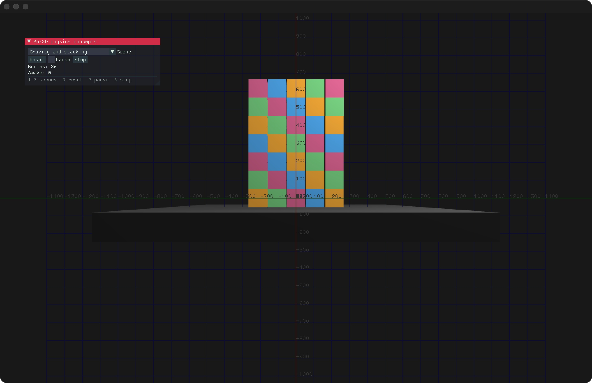
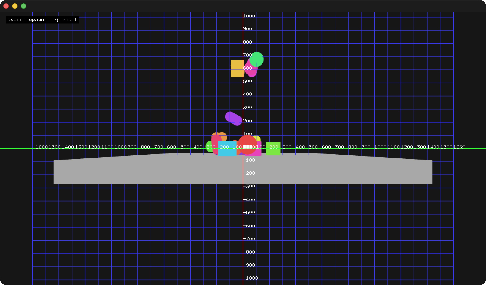
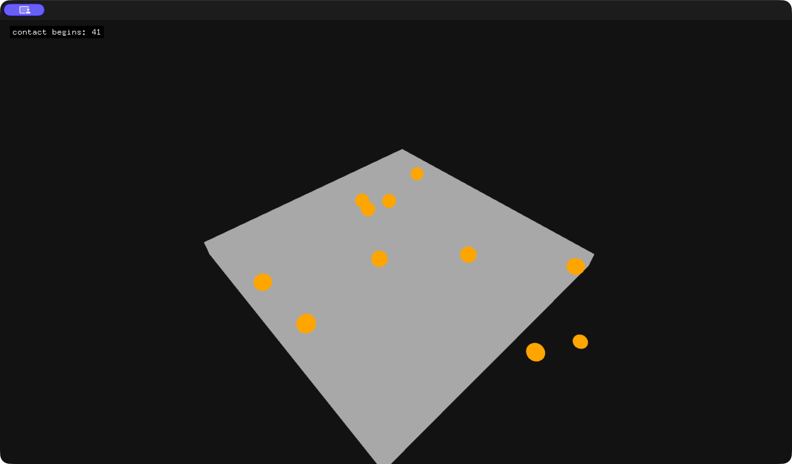

# ofxBox3d

3D rigid-body physics for openFrameworks, powered by [Erin Catto’s Box3D](https://github.com/erincatto/box3d).

Create boxes, spheres, and capsules; simulate collisions, forces, and joints; and render them with openFrameworks. Use the C++ helpers for everyday tasks or access the full Box3D C API through the exposed world and body IDs.

**Status:** Alpha. **Box3D version:** 0.1.0, pinned to [`3362633`](https://github.com/erincatto/box3d/commit/336263320469e5e9febfe18697ab562488f7e97a) (upstream `main`, 2026-10-27). SIMD is enabled by default.



## Features

- Fixed-timestep simulation with configurable frequency and substeps.
- Box, sphere, capsule, and static-ground factories with shared body settings.
- Move-only bodies that can live directly in `std::vector`, plus the existing shared-pointer workflow.
- Safe body destruction after world teardown or reset, including reused world slots.
- `ofNode` transforms, colors, filled/wireframe rendering, and an optional world-to-render scale.
- Contact, hit, and sensor events through `ofEvent`.
- Separate world-position conversions for Box3D’s optional double-precision mode.
- Native SIMD selection, CMake integration, and Apothecary binary build scripts.
- Interactive examples with camera controls and adjustable grids.

## Requirements

- openFrameworks 0.12+; validated with the local openFrameworks development checkout.
- A C++17 compiler and a C17 compiler for Box3D.
- CMake 3.22+ for CMake builds. Classic Project Generator/Makefile projects compile the sources directly.
- `ofxImGui` is required only by `physicsConceptsExample`.

## Installation

Clone into your openFrameworks `addons` directory:

```bash
cd openFrameworks/addons
git clone https://github.com/danoli3/ofxBox3d.git
cd ofxBox3d
git submodule update --init --recursive
```

Add `ofxBox3d` to your project’s `addons.make`, then generate or update the project with the openFrameworks Project Generator. Include `ofxBox3dAll.h` for the complete wrapper API.

After pulling an update, initialize the submodules again and regenerate your project so newly added or renamed Box3D sources are included:

```bash
git pull
git submodule update --init --recursive
```

## Examples

Open an example directory in Project Generator, select your openFrameworks installation, generate for your platform, and build/run the resulting project. On platforms with generated OF Makefiles, `make Debug` builds the example.

| Example | What it demonstrates | Controls |
| --- | --- | --- |
| [basicExample](examples/basicExample) | Boxes, spheres, capsules, and spawning | Space: spawn; R: reset; G: grid; H: half/full grid opacity |
| [contactEventsExample](examples/contactEventsExample) | Sphere contacts and a live contact counter | Drag/scroll to move the camera |
| [physicsConceptsExample](examples/physicsConceptsExample) | Seven physics scenes with an ImGui control panel | 1–7: scenes; R: reset; P: pause; N: step; G: grid; H: opacity |

The concepts panel also has a **Grid** checkbox and a **Grid opacity** slider. Grids start at half opacity; hiding a grid preserves its selected opacity. Drag to orbit and scroll to zoom with `ofEasyCam`.

For `physicsConceptsExample`, install [ofxImGui](https://github.com/jvcleave/ofxImGui) beside this addon. Its scenes cover stacking, friction, restitution, body types, forces/impulses, continuous collision, and a distance joint.

### Screenshots

These are captures of the running examples on macOS.

| Mixed shapes | Contact events |
| --- | --- |
|  |  |

## Quick start

This complete `ofApp.h` uses value-owned bodies. Keep your normal openFrameworks `main.cpp`.

```cpp
#pragma once
#include "ofxBox3dAll.h"

class ofApp : public ofBaseApp {
public:
    ofxBox3d physics;
    ofxBox3dBox ground;
    std::vector<ofxBox3dBox> boxes;
    ofEasyCam camera;

    void setup() override {
        ofxBox3dUtils::setScale(100.f); // 100 OF units = 1 meter
        physics.setup({0.f, -981.f, 0.f});
        ground = physics.createStaticBox({0.f, -100.f, 0.f},
                                         {800.f, 50.f, 800.f});
        ground.setColor(ofColor::darkGray);

        ofxBox3dBodySettings settings;
        settings.friction = 0.5f;
        settings.restitution = 0.1f;
        for (int i = 0; i < 8; ++i) {
            boxes.push_back(physics.createBox({0.f, 100.f + i * 110.f, 0.f},
                                              {50.f, 50.f, 50.f}, settings));
            boxes.back().setColor(ofColor::orange);
        }
        camera.setDistance(1800.f);
    }

    void update() override {
        physics.update(); // elapsed-time accumulation; 60 Hz, 4 substeps
    }

    void draw() override {
        ofBackground(22);
        ofEnableDepthTest();
        camera.begin();
        ground.draw();
        for (const auto& box : boxes) box.draw();
        camera.end();
        ofDisableDepthTest();
    }
};
```

Box dimensions are **half extents**. Sphere radius and capsule height/radius are in OF units. Capsule height includes both hemispherical ends.

## Factories and settings

```cpp
auto sphere = physics.createSphere({0.f, 500.f, 0.f}, 50.f);
auto capsule = physics.createCapsule({150.f, 500.f, 0.f}, 40.f, 160.f);

ofxBox3dBodySettings settings;
settings.type = b3_dynamicBody;
settings.density = 2.f;
settings.friction = 0.6f;
settings.restitution = 0.3f;
settings.isBullet = true;
settings.enableContactEvents = true;
auto box = physics.createBox({0.f, 800.f, 0.f}, {50.f, 50.f, 50.f}, settings);
```

Settings also expose rotation, damping, gravity scale, sleep, sensor behavior, event flags, and user data. Factories initialize the world with its defaults if needed. Call `setup()` first to choose your gravity, or `setupWithDefinition()` to supply a raw `b3WorldDef` in Box3D units.

### Ownership and rendering

Factory results own their physics bodies and can be moved, but cannot be copied. Destroying a body releases it; destroying/resetting its world invalidates the body safely.

Factories return **unregistered value objects**. `physics.update()` simulates them, and their `draw()` methods read the current physics transform. Draw them individually. Call `syncFromPhysics()` when other code needs the inherited `ofNode` transform, such as an attached scene node.

The existing `setup()` and `addBody()` workflow is still supported. To let the world synchronize and draw a body automatically:

```cpp
auto box = std::make_shared<ofxBox3dBox>(
    physics.createBox({0.f, 500.f, 0.f}, {50.f, 50.f, 50.f}));
physics.addBody(box);
// physics.draw() draws registered bodies.
```

Moves transfer physics ownership, local transform, style, and the parent link. Child nodes stay attached to the original `ofNode`; keep bodies at stable addresses (for example, in shared/unique pointers) when building a node hierarchy.

### Events and simulation controls

Enable contact/hit/sensor events through body settings or the corresponding `enableContactEvents()`, `enableHitEvents()`, and `enableSensorEvents()` methods. Subscribe to these world events with normal OF listeners:

- `contactBeginEvent`, `contactEndEvent`, `contactHitEvent`
- `sensorBeginEvent`, `sensorEndEvent`

See [contactEventsExample](examples/contactEventsExample/src/ofApp.cpp) for a complete listener example.

Use `setFixedHz()` and `setSubStepCount()` to tune stepping. `getBodyCount()` and `getAwakeBodyCount()` report all bodies, including value-owned bodies. `getWorldId()` and `getBodyId()` expose the underlying C API for joints, queries, and other upstream features.

## CMake and SIMD

Build the standalone Box3D library from this repository:

```bash
cmake -S . -B build -DCMAKE_BUILD_TYPE=Release
cmake --build build --parallel
```

In an application that already configures openFrameworks:

```cmake
add_subdirectory(${OF_ADDONS_DIR}/ofxBox3d ${CMAKE_BINARY_DIR}/ofxBox3d)
target_link_libraries(${APP_NAME} PRIVATE ofxBox3d::ofxBox3d)
```

The interface target adds the wrapper sources to your application and links Box3D. Your app supplies the openFrameworks target/includes/platform configuration.

SIMD is enabled by default: NEON on ARM64, SSE2 on x86, and runtime AVX2 dispatch on supported x86 builds. Visual Studio Project Generator builds use SSE2; CMake retains upstream’s per-file AVX2 compiler settings.

To use the scalar path:

```bash
cmake -S . -B build-scalar -DBOX3D_DISABLE_SIMD=ON
cmake --build build-scalar --parallel
```

For addon source builds, uncomment `ADDON_DEFINES += BOX3D_DISABLE_SIMD` in `addon_config.mk`, then regenerate and rebuild. Leave this macro undefined to enable SIMD; defining it as `0` still disables it.

### Double-precision world positions

Configure with `-DBOX3D_DOUBLE_PRECISION=ON`, or enable `BOX3D_DOUBLE_PRECISION` in `addon_config.mk` for source builds. Rebuild the engine and application together so their ABI agrees.

Use `setPositionDouble(glm::dvec3)` and `getPositionDouble()` for high-precision positions. The utilities `toB3Position()`, `toOfPosition()`, and `toOfPositionDouble()` distinguish world positions from float vectors. OF rendering and inherited `ofNode` transforms remain float-based.

See [the integration guide](docs/integration.md) for more build details, and [binary tooling](scripts/README.md) for Apothecary builds and release archives.

## Validation

CI builds the engine and runs upstream tests with SIMD enabled and disabled on macOS, Linux, and Windows. The wrapper regression suite covers world teardown/reuse, raw-handle destruction, move ownership, vector relocation, settings, rendering transforms, and position conversion.

To enable wrapper tests in a CMake application, first define your openFrameworks target, then set `OFXBOX3D_BUILD_TESTS=ON` and `OFXBOX3D_OPENFRAMEWORKS_TARGET` to that target’s name before adding this addon. Build `ofxBox3d_tests`; the suite runs without creating a graphics window. Run it in both precision modes when changing the ABI.

## License and credits

This addon is [MIT licensed](LICENSE). Box3D is MIT licensed, © Erin Catto.

- [Erin Catto](https://github.com/erincatto): Box3D.
- [2bbb](https://github.com/2bbb): co-author credit for the ownership, factory/settings, move-only body, and position-conversion improvements inspired by [ofxBox3D](https://github.com/2bbb/ofxBox3D).
- [Todd Vanderlin](https://github.com/vanderlin): [ofxBox2d](https://github.com/vanderlin/ofxBox2d), an inspiration for the addon.
